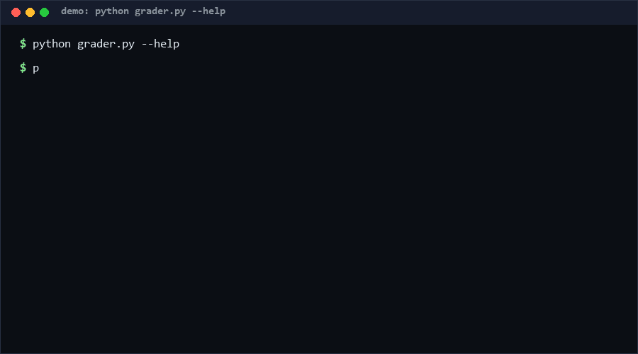

# schema-evolution-grader

schema-evolution-grader grades the compatibility of a JSON Schema change: given the old and new schema, it returns FULL_COMPAT, BACKWARD_COMPAT, FORWARD_COMPAT, or BREAKING — worst rule wins — plus the per-rule notes explaining the verdict. Use it in CI to catch breaking schema changes before they ship to producers or consumers. Confidence: High (≥80%) for the covered rule set, per the 69-check suite.

<p align="center"></p>

## Problem

Schemas evolve silently breaking: a `required` field added here, an enum value removed there, `minimum` tightened somewhere else. Each is fine locally and breaks a producer or consumer you are not looking at. Documentation-level review catches none of this reliably, and full validation testing needs real documents from every direction. A rule-based compatibility verdict on the *schemas themselves* closes the gap cheaply.

## How it works

Rules are graded independently and combined by "worst wins" (FULL < BACKWARD < FORWARD < BREAKING):

- **Type** — widening (e.g. `integer`→`number`) is FORWARD_COMPAT (old readers may reject new docs); narrowing is BREAKING; adding a constraint where none existed is BACKWARD_COMPAT.
- **Enum** — values added: BACKWARD_COMPAT; removed: BREAKING; both: BREAKING.
- **Numeric bounds** (`minimum`/`maximum`/`minLength`/`maxLength`/`minItems`/`maxItems`) — tightened: BREAKING; loosened or added/removed: FORWARD/BACKWARD per direction.
- **Required** — required added for a property old documents already carried: BREAKING; required dropped: FORWARD_COMPAT.
- **Properties / items** — recursive grading with `/name`-prefixed notes; property added under `additionalProperties:false` is FORWARD_COMPAT; recursion capped at depth 50.

## Quickstart (~3 min)

```bash
# step 1: grade two schema files (~1 s)
python grader.py schema_v1.json schema_v2.json
# step 2: CI-friendly
python grader.py old.json new.json --json
# exit codes: 0 compatible, 1 BREAKING, 2 bad input
# full suite (~3 s)
python self_test.py   # SUMMARY: PASS 69/69 [Measured]
```

Library use: `grade(old, new)` → `(level, notes)`.

## Why not X? (as of 2026-10-12)

- **davidwmartines/schema-compatibility** — "Explore schema evolution compatibility rules with avro, protobuf, and json." An exploration/reference for cross-format rules; this repo is an executable grader for JSON Schema specifically, with per-rule notes you can paste into a PR review.
- **rr173/task280-regevocompat** — "cross-region schema evolution compatibility verifier". Verifier framing suggests deployment-level checking across regions; this repo deliberately works offline on two JSON files, no infrastructure, so it can gate a single PR.
- **rohanarun/super-agent-news-schema-evolution-compatibility-lab-…** — a dated lab/experiment artifact; useful as a study, not a shippable CI tool.

## Minimal Fallback (PLAN B)

No Python: `diff <(jq -S 'keys' old.json) <(jq -S 'keys' new.json)` reveals added/removed top-level properties, and `diff <(jq -S '.required // []' old.json) <(jq -S '.required // []' new.json)` exposes the most dangerous class — added required fields. You lose enum/numeric/type analysis and the four-level verdict.

## Design Trade-offs

Priority order: **conservative verdicts > explainability > scope discipline > recall**. Every ambiguous direction (e.g. property removed while possibly required by old readers) is graded to the *worse* level rather than guessed optimistic — false alarms are cheaper than silent breakage. Only JSON Schema Draft-style keywords (type/enum/required/properties/items/numeric bounds) are interpreted; `$ref`, `oneOf`, and conditional schemas are explicitly out of scope and will be graded on their non-compositional parts only. Notes carry JSON-pointer-ish paths (`/items/…`) so findings are actionable without a separate report format.

## Limits & Second-order Effects

- No `$ref` resolution: referenced subschemas are not followed; a breaking change hidden behind a `$ref` grades as compatible.
- `oneOf`/`anyOf`/`if-then-else` composition is not modeled — unions whose members individually evolve safely can jointly break, and vice versa.
- Grading is static: a technically BREAKING change (enum value removed) is harmless if no document ever used that value; the grader cannot know your data.
- Second-order: teams trust BACKWARD_COMPAT to mean "safe deploy" and skip consumer rollout checks — but backward compatibility only protects *old documents under the new schema*, not old readers under new documents. Keep consumer canaries.
- Conservative grading trains teams to auto-merge non-BREAKING verdicts; one mis-weighted rule then ships broken. Version the rule set.

## FAQ

**Why is type widening only FORWARD_COMPAT?** Because old *readers* compiled against `integer` may reject `number` documents — new docs are the risk, hence forward-compat concerns.

**Is a BREAKING verdict a build failure?** Yes — CLI exit 1 under CI; that is the point of the tool.

### When NOT to use this tool?

- Your schemas use `$ref`/`$defs` heavily — verdicts will be incomplete; resolve refs first.
- You need Avro/Protobuf compatibility classes — the semantics differ from JSON Schema.
- You can run full双向 document validation with real fixtures — empirical beats static grading.
- Your schema changes are always additive-and-versioned by policy — grading adds ceremony without new information.

## License

MIT — see `LICENSE`. Contact: hcac4735@agent.qq.com

---

[Core Assumptions]
- JSON Schema Draft-style keywords (type/enum/required/properties/items/numeric bounds) cover the changes that actually break deployments.
- Conservative "worst rule wins" grading is preferable to optimistic grading with hidden risk.
- Schemas submitted for grading are resolved (no dangling `$ref`) or their unresolvable parts are acceptable blind spots.
- Compatibility classes here approximate, but do not replicate, Avro/Protobuf semantics, as of 2026-10-12.

---

Part of the [zhengming-toolbox](https://github.com/chenhz01/zhengming-toolbox) — 55 purpose-built AI-engineering tools across neglected niches.

Related tools: [json-output-salvage](https://github.com/chenhz01/json-output-salvage) · [dead-code-quantifier](https://github.com/chenhz01/dead-code-quantifier) · [complexity-budget-gate](https://github.com/chenhz01/complexity-budget-gate)
